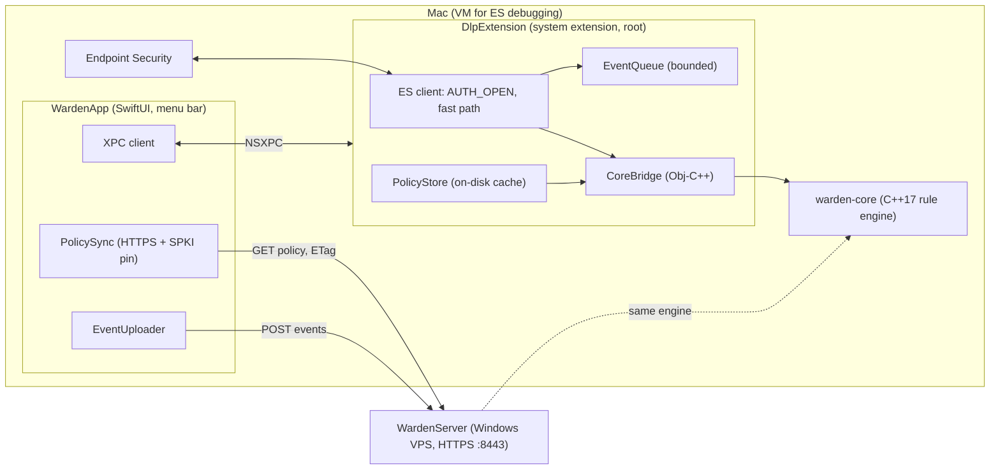

# warden-macos

macOS agent of **Warden**, a lightweight Endpoint DLP. It denies opening protected files (secrets such as `.env` and `~/.ssh`) to processes on an admin-managed blocklist (browsers, AI apps, anything the admin adds). Decisions use metadata only; file contents are never inspected. The agent consists of a menu bar app (WardenApp), an Endpoint Security system extension (DlpExtension) and an Objective‑C++ bridge (CoreBridge) to the shared C++17 rule engine from [warden-core](external/warden-core). Policies live on a server and are pulled over pinned HTTPS. Failures fail open: the agent must never block the user's work.

- Design: [docs/superpowers/specs/2026-10-20-warden-design.md](docs/superpowers/specs/2026-10-20-warden-design.md)
- Plans: [docs/superpowers/plans/](docs/superpowers/plans/)
- Decisions: [docs/adr/](docs/adr/)
- End-to-end checklist: [docs/e2e-checklist.md](docs/e2e-checklist.md)

## Architecture



The app, not the extension, fetches the policy every 10 s and pushes it to the extension over XPC; the extension keeps an on-disk cache, so enforcement does not depend on the app. The app drains events from the extension and uploads them.

## Quick start in the VM

Endpoint Security needs a restricted entitlement that only a paid Apple account can get, so v0.1 runs ad-hoc signed in a macOS VM with SIP disabled (see [ADR-0001](docs/adr/0001-adhoc-signed-es-extension.md)). Never do this on the host.

1. Prepare the guest as in [docs/vm-setup.md](docs/vm-setup.md) (snapshot `es-ready`, at least 2 vCPU).
2. On the host, build and ad-hoc sign: `scripts/build.sh`.
3. Copy `build/Build/Products/Debug/WardenApp.app` into the guest's `/Applications`.
4. Launch it, install the extension, approve it in System Settings (Login Items & Extensions) and grant Full Disk Access as described in [docs/vm-setup.md](docs/vm-setup.md). Whether the app (as opposed to the extension) strictly needs it is confirmed in ADR-0001 after the VM run.
5. In Settings enter the server URL, the SPKI pin and the agent token (from the password manager; never commit them).

The full verification procedure is in [docs/e2e-checklist.md](docs/e2e-checklist.md).

## Build, test, lint

Requires Xcode 27 and [mise](https://mise.jdx.dev) (pins Tuist), plus `swiftlint` and `swiftformat` (Homebrew).

```sh
mise install            # Tuist 4.212.0
scripts/build.sh        # tuist generate, unsigned xcodebuild into build/, then ad-hoc sign (ADR-0001)
scripts/test.sh         # unit tests for DlpExtensionTests and WardenAppTests (--coverage adds coverage)
scripts/coverage.sh     # tests with coverage, then the >= 80 % line gate (scripts/coverage_gate.py)
scripts/lint.sh         # swiftlint --strict and swiftformat --lint
```

## Limitations

From [ADR-0001](docs/adr/0001-adhoc-signed-es-extension.md) and the v0.1 design:

- No paid certificate: the extension is ad-hoc signed and runs only in a VM with SIP disabled and AMFI relaxed. It cannot run on an ordinary Mac.
- Ad-hoc signing and the Full Disk Access grant are done by hand; every rebuild replaces the extension and needs the approval cycle again.
- Deny covers writes as well as reads: policy evaluation sees every open regardless of access mode.
- After `kill -9` the extension is restarted by sysextd; a fail-open window of 15 s was measured on one run (see ADR-0001, "Verified in Plan 4").
- The NSXPC peer requirement can only check the bundle identifier (no Team ID).
- The pinned server certificate has no expiry or hostname check (parity with `curl --pinnedpubkey`); revocation means changing the pin.
- The agent token is stored in the legacy file keychain, and the ad-hoc signature changes with each build, so the token may need to be re-entered after a rebuild.
- Pending events (up to 5000) are held in memory and are lost if the app quits or crashes while the server is unreachable. Live block notifications are best effort.
- Drained events can be lost if the XPC reply arrives after the timeout or the app is cancelled (a peek/ack drain is future work).
- One hung process lookup can fill the extension's in-flight cap and temporarily disable evaluation (fail-open by design, logged).
- Threat model is accidental leakage by a non-malicious user. Not defended: renaming, copying or hard-linking a protected file, stopping or uninstalling the agent, tampering with the policy on the device.

## Writing policies

- Process matchers use `teamId`, `signingId`, `signingIdPrefix` or `path` only; `name` is rejected.
- Prefer `signingIdPrefix` or `teamId`. A `path` matcher must be the real executable at open time, not a shim such as `/usr/bin/python3`.

## Roadmap

1. Paid Apple Developer certificate and the real ES entitlement.
2. Notarization.
3. Installer (pkg) and self-update.
4. Tamper protection (stop/uninstall resistance, server-signed policies).
5. NetworkExtension and network filtering.
6. Content inspection (secret patterns).
7. Windows agent.
8. MDM deployment.
